

<a href="https://drakos.gg/">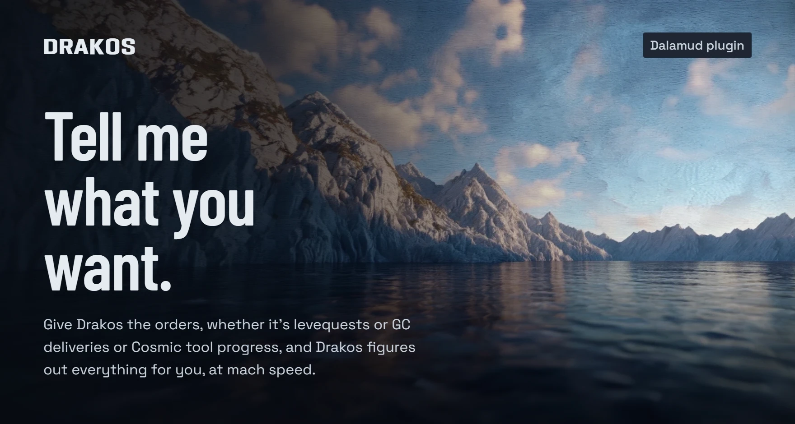</a>

# Drakos, an FFXIV crafting bot

Drakos is an [FFXIV crafting bot](https://drakos.gg/ffxiv-crafting-bot/). It runs as a Dalamud plugin for Final Fantasy XIV. Add the items you want to an order, and Drakos works out what to craft, gather, and buy, then does the work.

<a href="https://www.youtube.com/watch?v=ZSbmGxxZPAw">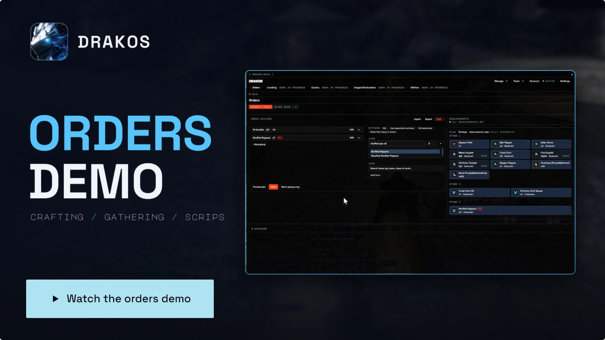</a>

<a href="https://drakos.gg/updates/">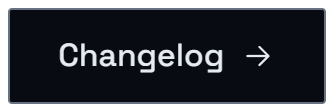</a>

 

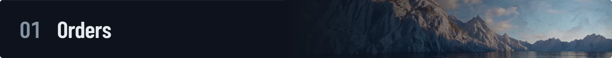

Drakos plans each order from the finished items you add. It counts the materials you already have, decides what to craft, gather, or buy, and schedules the work around timed nodes and travel. It also works out which intermediates need to be HQ to reach your quality target. You can put orders into groups that run in sequence, and import or export order lists.

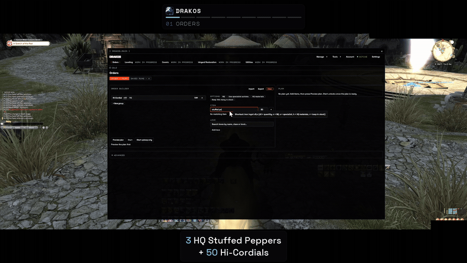

 

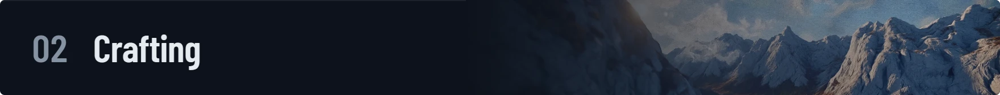

Drakos solves a rotation for your stats, starting quality, and HQ or collectability target, and adjusts it when the condition turns Good or Excellent. You can preview the rotation before you start. The crafting solver is based on [raphael-rs](https://github.com/KonaeAkira/raphael-rs).

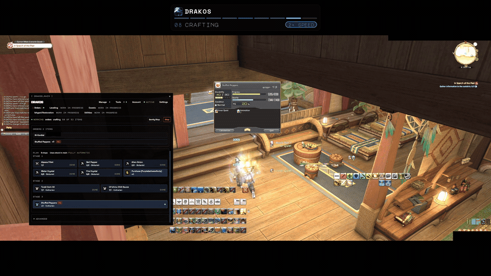

 

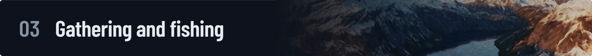

Drakos travels to regular, timed, and ephemeral nodes and solves a rotation for item yield or collectability from your stats, current GP, and the node's bonuses. For timed scrip routes and aethersand runs, it chooses which nodes to visit and plans GP and cordial use across the run. It also catches supported rod fish and reduces collectables into aethersands.

 

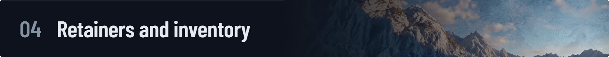

Drakos reprices your retainer listings using the undercut amount, price floor, and ceiling you set. A selling watchlist sets the items and quantities to sell, and Drakos posts available stock to retainers with free listing slots. It withdraws gil from your retainers after each undercut round. It can also move items you don't need into your saddlebag, retainers, or FC chest, and it retrieves materials from your saddlebag and retainers when an order needs them.

 

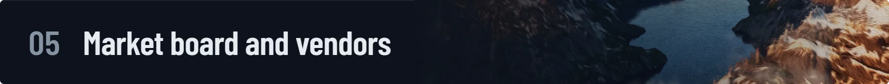

Drakos buys materials from market board listings, starting with the lowest prices. You can turn on world hopping and choose which worlds in your data center to shop on. It also buys order materials from NPC vendors and scrip exchanges, and turns in crafted or gathered collectables for scrips.

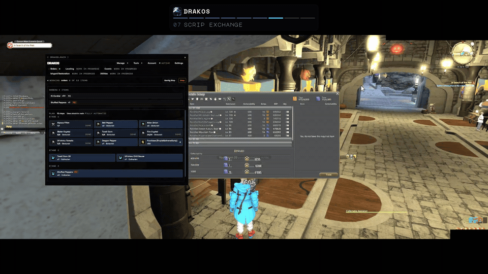

 

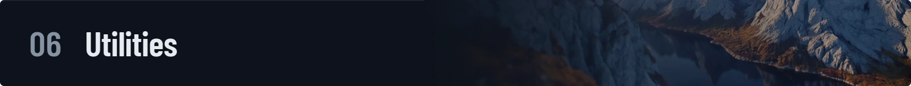

Pick the Grand Company Supply and Provisioning requests you want, and Drakos makes what is missing and hands it in.

Drakos also makes and hands in each Custom Deliveries recipient's weekly deliveries.

 

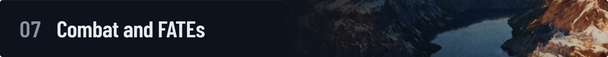

Drakos farms materials from supported mobs for your orders. FATE farming (beta) raises your Shared FATE ranks or farms bicolor gemstones.

 

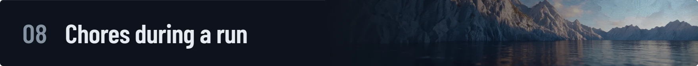

Optional hooks repair your gear, keep your food, medicine, and FC buffs active, use EXP manuals, and extract materia from fully spiritbonded gear. A restocking list for each character tops up supplies such as food and medicine before every order.

 

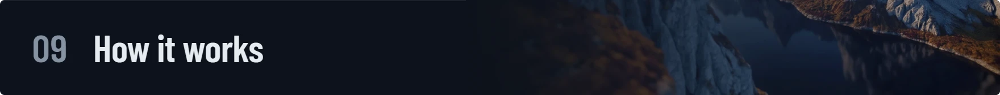

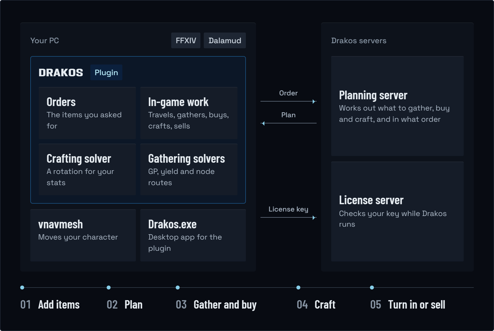

1. **You add items to an order.** The Drakos plugin runs inside the game through Dalamud. Drakos.exe is a desktop app that controls the same plugin.
2. **The planning server plans the order.** The plugin sends the order to the Drakos planning server, which answers with what to gather, buy, and craft, and in what order. If the server does not answer, the order waits and carries on once it does.
3. **The plugin does the work on your PC.** It solves each crafting and gathering rotation on your PC and moves your character with [vnavmesh](https://github.com/awgil/ffxiv_navmesh).
4. **The license server checks your key.** While Drakos runs, it checks in with the license server every 10 seconds. If it loses the server for 30 seconds, it finishes its current step and stops.

 

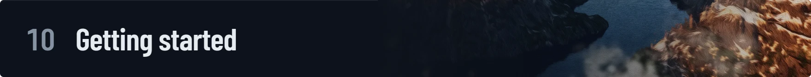

1. **Set up Dalamud.** Install XIVLauncher and enable Dalamud.
2. **Install the plugins.** Follow the [installation guide](https://drakos.gg/installation/) to add vnavmesh and Drakos.
3. **Sign in with your key.** Find your license key on your [account page](https://drakos.gg/accounts/). Open `/drakos`, save your key, and sign in.
4. **Add your first order.** Choose what you want to craft or gather, then start the order.

Drakos needs Windows 10 or 11 (64-bit) and the English FFXIV client. The [pricing page](https://drakos.gg/pricing/) lists the current plans.

 

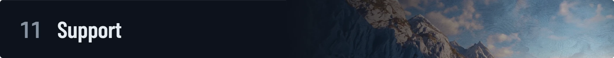

Ask questions and report bugs on [Discord](https://discord.gg/sgKnHh8CRd). For account and purchase help, email [support@drakos.gg](mailto:support@drakos.gg). Check [status.drakos.gg](https://status.drakos.gg) for service status.

Drakos is not affiliated with or endorsed by Square Enix or the Dalamud team.
